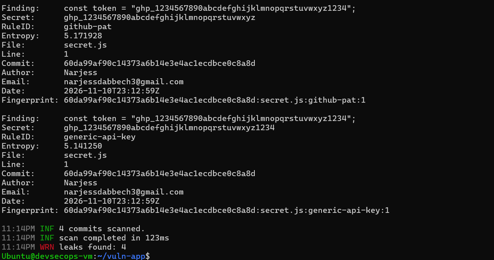
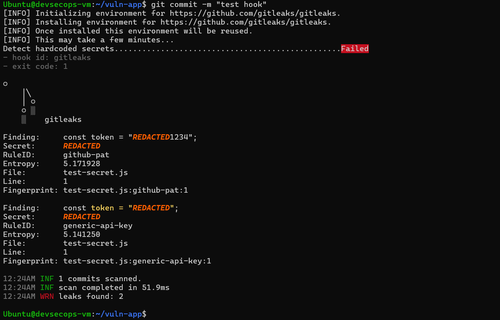
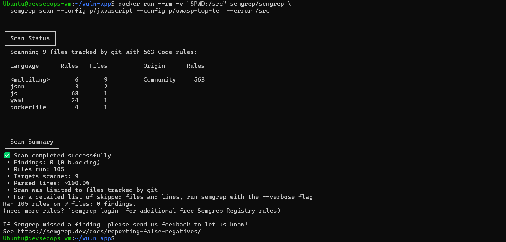
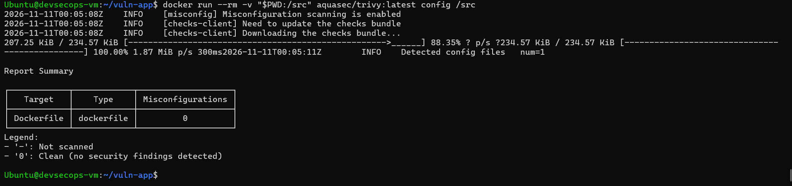
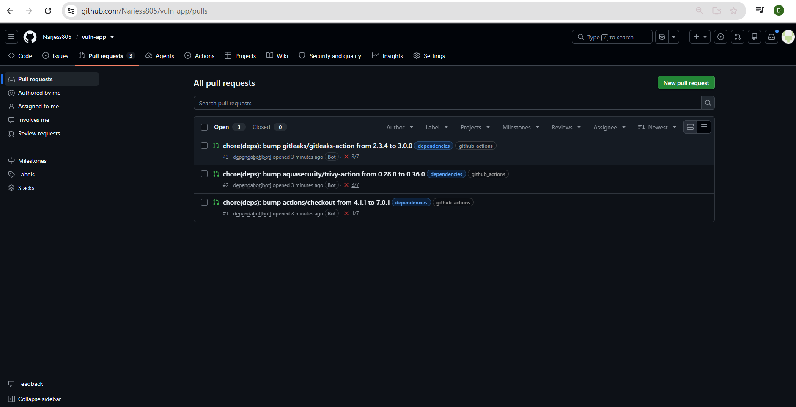
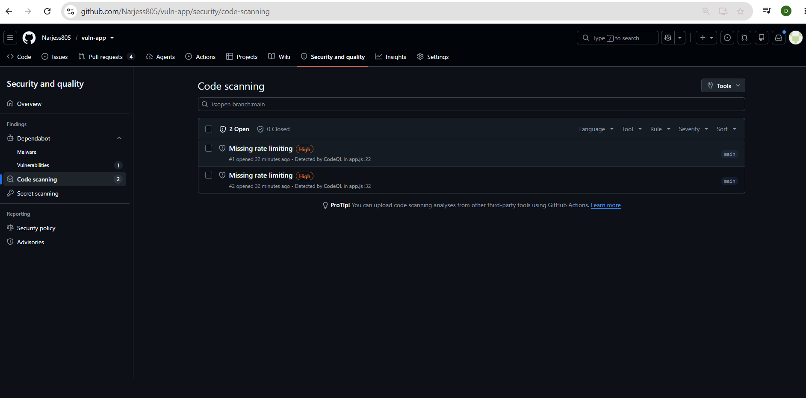
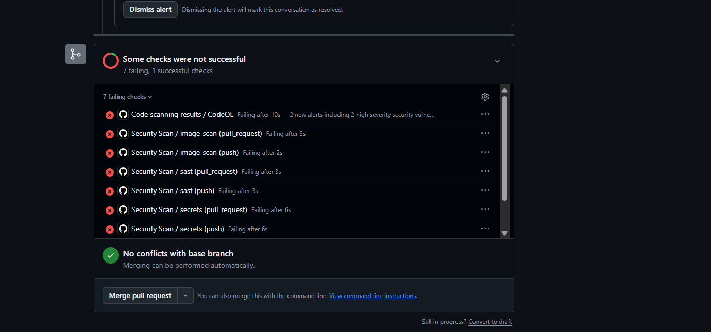
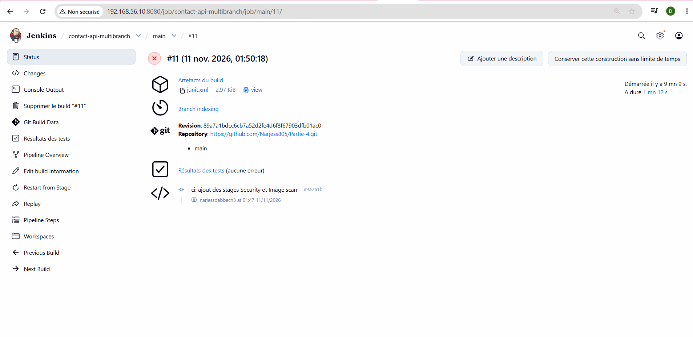

# TP10 — DevSecOps « Shift Left »

Analyse d'une application volontairement vulnérable avec les outils open source standard (Gitleaks, Semgrep, Trivy, CodeQL, Dependabot) et intégration dans GitHub Actions et Jenkins.

## 📋 Sommaire
1. [Carte des scanners](#1-carte-des-scanners)
2. [Partie 1 : Secrets avec Gitleaks](#2-partie-1--secrets-avec-gitleaks)
3. [Partie 2 : Hook pre-commit](#3-partie-2--hook-pre-commit)
4. [Partie 3 : SAST avec Semgrep](#4-partie-3--sast-avec-semgrep)
5. [Partie 4 : Dépendances et Images](#5-partie-4--dépendances-et-images)
6. [Partie 5 : GitHub (CodeQL, Dependabot)](#6-partie-5--github-codeql-dependabot)
7. [Partie 6 : Quality Gates Jenkins](#7-partie-6--quality-gates-jenkins)
8. [Livrables](#8-livrables)

---

## 1. Carte des scanners

| Famille | Question posée | Outils utilisés |
|---|---|---|
| Secrets | Un token est-il dans Git ? | Gitleaks, push protection GitHub |
| SAST | Le code contient-il des motifs dangereux ? | Semgrep, CodeQL |
| SCA | Les dépendances ont-elles des CVE ? | npm audit, Dependabot |
| Image | L'image a-t-elle des CVE ? | Trivy image |
| Config | Le Dockerfile est-il mal configuré ? | Trivy config |

---

## 2. Partie 1 : Secrets avec Gitleaks

Gitleaks a scanné l'historique Git et détecté des secrets en dur (token GitHub, token AWS).

**Correction** : les secrets ont été déplacés dans des variables d'environnement (`process.env`), un fichier `.env.example` a été créé, et `.env` a été ajouté au `.gitignore`. L'historique a été nettoyé (`rm -rf .git` puis `git init`).

---

## 3. Partie 2 : Hook pre-commit

Le hook `pre-commit` a été installé et configuré pour lancer Gitleaks avant chaque commit. Un commit contenant un faux secret a été bloqué.

---

## 4. Partie 3 : SAST avec Semgrep

Semgrep a détecté des failles dans `app.js` :
*   Injection SQL (`db.all` avec concaténation)
*   Injection de commande (`exec` avec `${host}`)
*   XSS (`res.send` avec `${name}`)
*   JWT sans expiration

### Avant / Après correction

**Corrections** : requêtes paramétrées, `execFile` avec validation, `res.json` au lieu de HTML, `expiresIn` sur le JWT.

---

## 5. Partie 4 : Dépendances et Images

### npm audit

`npm audit` a trouvé des vulnérabilités dans les dépendances de développement (`tinypool`, `esbuild`, `vitest`).

### Trivy (image et config)

**Avant correction** : image `node:14` vulnérable, tourne en root, pas de HEALTHCHECK.

**Après correction** : image `node:24-alpine`, multi-stage, `USER node`, HEALTHCHECK.

---

## 6. Partie 5 : GitHub (CodeQL, Dependabot)

### Dependabot

Dependabot a ouvert des Pull Requests pour mettre à jour les GitHub Actions (`checkout`, `trivy-action`, `gitleaks-action`).

### CodeQL

CodeQL a analysé le code et détecté l'injection SQL réintroduite dans la branche `feature/broken-sql`.

### PR bloquée

La Pull Request réintroduisant l'injection SQL a été bloquée par les checks de sécurité obligatoires (`sast`, `secrets`, `image-scan`).

---

## 7. Partie 6 : Quality Gates Jenkins

Ajout des stages `Security` (Gitleaks, Semgrep, npm audit) et `Image scan` (Trivy) dans le `Jenkinsfile`.

### Pipeline rouge (faille réintroduite)

### Pipeline vert (faille corrigée)

---

## 8. Livrables

| Fichier | État |
|---|---|
| Code corrigé | ✅ |
| `security.yml` (workflow GitHub Actions) | ✅ |
| `dependabot.yml` | ✅ |
| `Jenkinsfile` (avec stages Security) | ✅ |
| `captures/gitleaks.png` | ✅ |
| `captures/pre-commit-blocked.png` | ✅ |
| `captures/semgrep-before-after.png` | ✅ |
| `captures/trivy-before-after.png` | ✅ |
| `captures/dependabot-pr.png` | ✅ |
| `captures/codeql-alerts.png` | ✅ |
| `captures/pr-blocked.png` | ✅ |
| `captures/jenkins-security.png` | ✅ |

---

## Auteur

- **Nom** : Narjess Dabbech
- **Année** : 2025–2026
